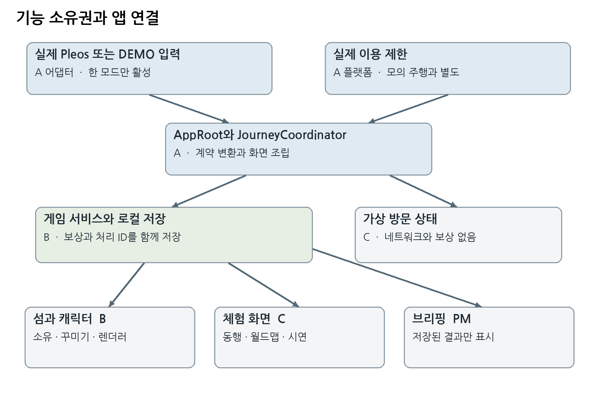

# 2 역할 배분과 시스템 구조

이번 배포에서 파트 1=A, 파트 2=B, 파트 3=C, PM=P다. 작업 ID는 유지하며 실제 배정은 config/team.json에서 한 번만 기록한다. 사용자용 앱 이름은 MEMORIDE이고 카일랜드는 가상 세계관이다.

## 2 1 역할을 나누는 원칙

화면 수나 코드 줄 수를 같게 만드는 대신, 구현·테스트·오류 수정·문서화가 포함된 개발 노력의 목표를 A:B:C:PM = 2:2:2:1로 둔다. 계획 포인트는 A 20, B 20, C 20, PM 10이다. 포인트는 팀 안의 상대 추정치이며 실제 난이도가 공평하다고 입증한 측정값은 아니다. D3과 D7에 실제 소요·남은 작업을 확인하고 1~3포인트의 독립 작업을 옮긴다. PM의 일정·발표·제출 관리 시간은 이 개발 비율 밖이다.

서로의 코드를 기다리지 않도록 각 파트가 테스트 데이터와 임시 화면을 갖는다. 하나의 Android 앱과 하나의 Gradle app 모듈 안에서 디렉터리로 소유권을 나눈다. 2주 팀에 마이크로서비스·다중 저장소·복잡한 다중 모듈 빌드는 도입하지 않는다. 단일 모듈의 경계는 빌드가 자동 강제하지 않으므로 PR에서 기능 간 직접 import와 공용 파일 수정을 확인한다.

| 담당 | 개발 소유권 | 기본 포인트 | 맡지 않는 일 |
|---|---|---|---|
| A 플랫폼과 여정 | 프로젝트, 앱 조립, 화면 라우터, Pleos 어댑터, 여정 상태, 플랫폼 제한, 빌드·release | 20 | 섬 보상 결정, 다른 파트 내부 오류 전체 수정 |
| B 섬과 게임 | 게임 상태·저장, 성장·보상, 섬, 인벤토리, 꾸미기, 캐릭터 렌더러 | 20 | SDK 객체 해석, 지도 화면·가상 방문 |
| C 여정 체험 | 모의 내비, 가상 방문, 월드맵·간단 도감 UI, 시나리오 패널·재생 | 20 | 실제 통신 서버, 영구 보상 저장, 실제 제한 해제 |
| PM 주준경 | 브리핑 화면·문구 포맷, 지역 JSON·시나리오 내용, 콘텐츠 검증 | 10 | 중앙 아키텍트·전원 디버거·모든 PR 승인자 |

작업별 점수의 세부 원본은 tasks/backlog.md 하나로 관리한다.

PM이 실제로 만드는 코드는 feature/briefing의 순수 화면과 문구 선택 함수, 콘텐츠 검증 코드다. 화면은 이미 확정된 결과를 입력받아 표시하고 콜백만 내보낸다. 보상 지급이나 SDK 호출은 하지 않아 독립 개발이 쉽다. 콘텐츠 원본 작성도 개발 산출물이나, PM의 전체 개발 시간을 데이터 입력만으로 채우지는 않는다.

## 2 2 파일 소유권

| 경로 | 소유자 | 변경 규칙 |
|---|---|---|
| app 빌드 파일, Manifest, Application, MainActivity, app 패키지 | A | 다른 담당자는 PR에 변경 요청 또는 작은 별도 커밋 |
| core/contract, core/ui, core/platform | A | 계약 의미 변경은 소비자 1명 확인, 제품 범위 변경만 PM |
| feature/island, game 저장 파일 | B | B가 내부 설계와 테스트를 자율 결정 |
| feature/companion, feature/visit, feature/world, feature/demo | C | C가 내부 설계와 테스트를 자율 결정 |
| feature/briefing, content, fixtures 시나리오 내용 | PM | 공통 ID·필드 삭제 시 영향 담당자 확인 |
| res/drawable의 char_와 item_ 자산 | B | 내용 제안은 PM, 실제 제작·정렬은 B |
| docs의 각 기능 설명 | 해당 담당자 | 기능 변경 PR에서 필요한 부분만 갱신 |

app/src/main/java/io/kailand 안에 app, core, feature를 둔다. 패키지 이름은 초기 내부 기본안이며 D1에 A가 확정한다. feature끼리 직접 참조하지 않는다. A가 AppRoot에서 데이터를 연결한다. 공용 색상·간격은 core/ui의 최소 테마로 시작하고, 화면별 작은 컴포넌트는 해당 폴더에 둔다. 모든 것을 공통 컴포넌트로 추출하지 않는다.

## 2 3 아키텍처

PleosJourneyAdapter와 DemoJourneyAdapter는 같은 여정 계약을 구현하지만 동시에 활성화하지 않는다. A의 JourneyCoordinator는 입력을 정규화하고 유효한 완료만 B의 GameService에 전달한다. B는 하나의 게임 저장소에서 중복 확인·보상·영수증 저장을 원자적으로 수행한다. A는 저장된 결과를 PM 브리핑에 넘긴다. C의 방문은 게임 저장과 독립된 일시 상태다.

모든 화면은 불변 데이터와 이벤트 콜백을 받는다. 화면 내부에서 다른 화면의 ViewModel, 파일, SDK 싱글턴을 찾아 쓰지 않는다. 구독은 StateFlow와 수명주기 인식 수집을 기본으로 하되, 작은 화면은 단순 상태 전달만으로 충분하다. 별도 DI 프레임워크 대신 AppContainer에서 생성자를 연결한다.

캐릭터 렌더러는 B가 만들고 AppRoot가 C의 동행 화면에 슬롯 함수로 전달한다. C는 개발 초기에 동일 크기의 회색 임시 캐릭터를 쓰며 B의 완성을 기다리지 않는다. 외형 데이터는 AvatarPreview로 전달한다. C가 의상 소유 규칙이나 보상 저장에 접근하지 않는다.

## 2 4 공정성과 병목 관리

A는 기술 불확실성이 크고 B는 구현량이 크다. C에게 월드맵·도감·시연 재생을 묶어 UI 물량을 분산하고 PM에게 별도 브리핑을 배정한다. SDK가 오래 걸리면 A에게 더 많은 통합 업무를 주지 말고, SDK 시도 시간을 제한한 뒤 C의 독립 UI 작업 일부를 넘기거나 선택 연동을 줄인다. B의 저장·보상 핵심은 중간에 나누지 않고, 자산 변형·카탈로그 문구·스타일 작업을 다른 사람에게 옮긴다.

각 파트의 작성자가 오류를 고치고 해당 담당자가 통합용 커밋을 준비한다. A는 연결 코드와 최종 빌드를 책임지지만 전원의 기능 버그를 대신 고치지 않는다. PM은 인수 기준과 범위 판단을 맡고 모든 구현 결정을 승인하지 않는다. 검토 대기 중에는 기존 계약의 가짜 입력으로 작업을 계속한다.

## 2 5 변경 권한

담당 폴더의 리팩터링·내부 변수·고정 계약 안의 UI 조정은 자율 처리한다. 선택 필드 추가·공용 타입 변경은 A와 실제 소비자에게 한 번에 짧게 요청한다. 서버 도입, 유료 기능, 핵심 기능 삭제, 주행 제한 완화, 저장 호환성 파괴, 1일 이상 일정 지연은 PM 검토 대상이다. 긴 회의를 기본값으로 두지 않는다. 기술적으로 더 간단하고 같은 기준을 충족하는 대안은 채택할 수 있다.

## 2 6 PM이 이해할 기능 분배

A는 차량에서 온 말을 앱이 이해할 수 있는 데이터로 바꾼다. B는 그 데이터로 게임 안에 무엇이 달라지는지 결정한다. C는 이동과 가상 방문을 눈으로 체험하게 만든다. PM은 이미 저장된 도착 결과를 짧은 이야기와 아이템 카드로 보여준다. 제품 컨셉과 개발 노력 2:2:2:1은 유지한다.

대전 도착의 예를 보면 A가 목적지와 유효한 완료를 확인하고, B가 대전 발견·선물 세 개·영수증을 한 번에 저장한다. AppRoot가 이 결과를 PM의 브리핑에 전달한다. C의 월드맵은 같은 GameSnapshot에서 발견 상태를 읽으며, 새 의상은 B의 AvatarPreview를 통해 섬과 C의 동행 화면에 함께 반영된다.

AppRoot는 기능을 연결하는 작은 조립부다. 복잡한 화면 코드는 각 담당 기능에 남긴다. A에게 브리핑 레이아웃·방문 문구·보상 오류 수정을 넘기지 않는다. 연결이 안 될 때 생산자는 약속한 입력·출력과 샘플을 확인하고, 소비자는 자신이 그 형식을 사용하는지 확인한다. 두 담당자가 짧게 재현한 뒤 원인이 있는 파트가 수정한다.

## 2 7 기다림을 줄이는 첫 전달물

| 담당 | 첫 전달물 | 상대가 기다리지 않는 방법 |
|---|---|---|
| A | A01 공통 앱과 계약, A02 fake 여정 | B·C·PM은 제공 UI 샘플로 순수 함수·화면 초안을 작성 |
| B | B01 기본 GameSnapshot과 서비스 골격 | C는 같은 크기 임시 캐릭터, PM은 샘플 영수증 사용 |
| C | C01 동행 화면과 C02 방문 상태 | A는 임시 화면으로 라우터 구성, 게임 저장과 독립 |
| PM | P01 브리핑 함수와 샘플 화면 | 보상 계산·SDK 성공을 기다리지 않고 화면 완성 |

각 담당자는 자기 기능을 호출하는 최소 예제와 검증 결과를 PR에 적는다. 별도의 전달 회의나 긴 보고서는 필요하지 않다. UI 공개 함수의 연결 표면은 `contracts/ui_contracts.md`를 D1에 A와 해당 담당자가 확인하고 동결한다. 이후의 내부 설계는 각자 결정한다.
