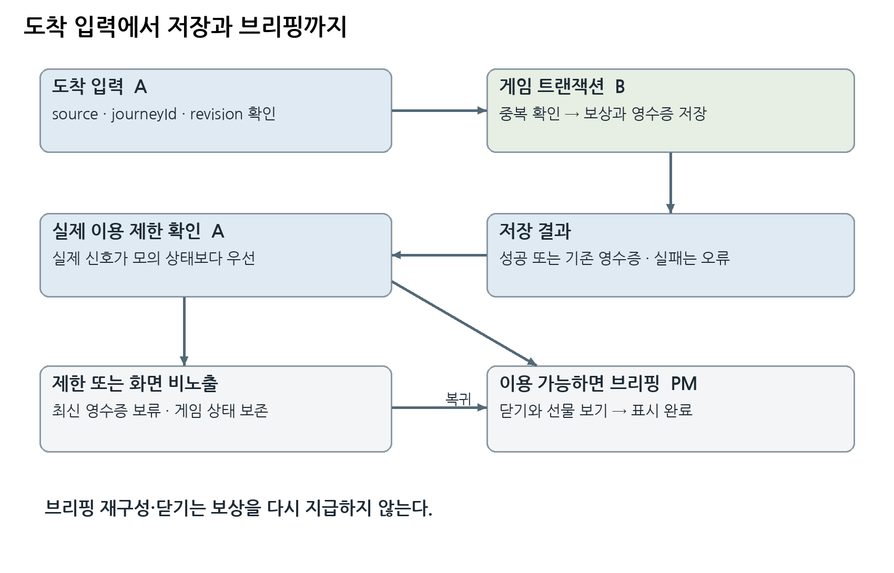

# 3 공통 계약과 데이터 흐름

## 3 1 계약을 작게 고정하기

공통 계약은 SDK 타입을 앱 안으로 복사한 것이 아니라 팀 기능을 연결하기 위한 자체 형식이다. SDK의 실제 콜백 서명은 설치 버전에 맞춰 A가 어댑터에서 변환한다. 필드 이름, 단위, null 의미, 호출의 성공·실패 의미를 먼저 맞추면 구현 세부사항은 각자 바꿀 수 있다. contracts/KailandContracts.kt는 시작용 타입 초안이며 Android 프로젝트에 옮겨 컴파일을 확인한 뒤 core/contract의 코드가 기준이 된다.

| 계약 | 생산자 | 소비자 | 반드시 지킬 의미 |
|---|---|---|---|
| JourneySnapshot | A | C와 앱 조립 | 목적지·단계·출처, 미지원 수치는 null |
| ArrivalCommand | A | B | 유효한 여정 ID와 최종 목적지 도착 근거 |
| GameSnapshot | B | 섬, 월드맵, 앱 조립 | 소유·발견·외형의 읽기 모델 |
| ArrivalReceipt | B | PM 브리핑 | 저장 성공한 변화, 중복이면 기존 영수증 |
| AvatarPreview | B | C와 브리핑 | 외형·착용 ID, 게임 상태 변경 권한 없음 |
| VisitState | C | C 내부 화면 | 동의와 세션 상태, 보상과 무관 |
| InteractionGate | A | 모든 화면 | 실제 플랫폼 상태 우선, UNKNOWN은 제한 |

기본 서비스 표면은 아래 정도로 제한한다. StateFlow는 최신 상태 읽기용이며 공개 mutable 상태를 노출하지 않는다. 화면 내부 함수와 UI 구성은 각 담당자가 설계한다.

| 호출 | 소유자 | 결과와 의미 |
|---|---|---|
| JourneyPort.requestDestination | A | 요청 접수 또는 실패, 도착 성공을 뜻하지 않음 |
| JourneyPort.cancel | A | 현재 여정 취소와 입력 세션 정리 |
| DemoControlPort.dispatch | A 구현, C 호출 | DEMO 모드의 출발·완료·취소만 허용 |
| GameService.completeArrival | B | Applied, AlreadyApplied, Rejected, StorageFailure |
| GameService.apply | B | 캐릭터·의상·음식·장식의 검증된 변경 |
| GameService.acknowledgeReceipt | B | 표시 완료만 기록, 보상 없음 |
| GameService.resetDemoProgress | B, A에서 연결 | 전체 초기화 확인 후 게임 저장만 초기화 |

PM 화면의 최소 입력은 ArrivalReceipt, 읽기용 카탈로그, AvatarPreview, InteractionGate와 닫기·아이템 열기 콜백이다. C의 월드맵도 읽기용 GameSnapshot·카탈로그와 인벤토리 열기 콜백만 받는다. 닫기 콜백의 실제 표시 완료 기록과 화면 전환은 A가 연결한다. 화면에서 다른 파트의 저장소나 ViewModel을 찾지 않는다.

## 3 2 데이터 사전

| 필드 | 형식과 단위 | 기준 |
|---|---|---|
| schemaVersion | 정수, 초기 1 | 게임 저장 형식 버전 |
| contentVersion | 문자열, 초기 1.1.0 | 콘텐츠 묶음 버전, 앱 버전과 별개 |
| profileId | 문자열, 초기 local-player | 로그인 계정 아님, 차량·인물 식별값 아님 |
| journeyId | 앱이 생성한 UUID 문자열 | 한 번의 여정 동안 유지, 콜백마다 재생성 금지 |
| source | DEMO 또는 PLEOS | 시작 시 고정, 중간 소스 전환 불가 |
| journeyKind | DAILY 또는 REGION | 시연 시나리오 태그, 실제 행동 자동 분류 아님 |
| regionId | 등록 ID 또는 null | null은 미등록 지역, 방문 보상 없음 |
| routeRevision | 0 이상 정수 | 목적지 변경 때 증가, 오래된 입력 거부 |
| elapsedSeconds | 0 이상 정수 또는 null | 앱이 관측한 구간 또는 명시적 모의 값 |
| distanceMeters | 0 이상 실수 또는 null | 해당 여정 거리로 검증한 값만 사용 |
| observedAtEpochMs | UTC epoch 밀리초 | 이벤트 진단용, 순서는 coordinator가 직렬화 |
| completedAtEpochMs | UTC epoch 밀리초 | 완료 시각, DAILY 키는 Asia/Seoul 날짜 |
| ownedItemIds | 중복 없는 문자열 집합 | content의 item ID 참조 |
| equippedOutfitId | item ID 또는 null | 소유한 OUTFIT만 허용 |
| decorationSlots | slot ID에서 item ID로 매핑 | 소유한 DECOR, 한 아이템의 중복 슬롯 배치 금지 |
| dailyGrowth | 0부터 3까지 정수 | 상한은 설정값, 계산과 저장은 B |
| processedReceipts | journey ID에서 원본 영수증으로 가는 맵 | 맵의 키가 처리 ID, 과거 도착 반복에도 기존 결과 반환 |

속도는 MVP 필수가 아니다. 추가할 때는 SDK 단위를 확인해 m/s와 km/h를 명시적으로 변환한다. 남은 거리·시간을 총 주행 거리·시간으로 사용하지 않는다. 경로 탐색 완료는 주행 완료가 아니다. null과 0을 구별하고 측정 실패를 숫자 0으로 보여주지 않는다.

## 3 3 데이터 흐름과 호출 순서

사용자가 목적지를 고르면 A가 새 journeyId와 routeRevision을 만든다. 요청 성공만으로 출발·방문·보상을 처리하지 않는다. 주행 상태와 도착 근거를 정규화한 뒤 ArrivalCommand를 B에게 보낸다. B의 completeArrival은 중복 여부 확인과 보상·영수증 갱신을 한 번의 저장 트랜잭션 안에서 수행한다. 성공이 확인된 뒤에만 PM의 브리핑을 연다. 저장 실패이면 성공 연출 대신 재시도를 안내한다.

도착 시 실제 조작이 제한되어 있으면 보상 결과는 저장하되 브리핑은 열지 않는다. 다음에 앱이 보이고 이용 가능할 때 저장된 pendingReceipt를 표시한다. 닫기·아이템 열기는 acknowledgeReceipt로 표시 완료만 기록하고 보상을 재실행하지 않는다. 동일 도착을 다시 받으면 같은 영수증을 반환하되 acknowledged 상태라면 자동 팝업을 다시 띄우지 않는다.

실제 SDK 프로세스가 종료된 동안 앱이 관측하지 못한 도착은 자동으로 복원했다고 주장하지 않는다. 작은 MVP에서는 활성 여정 자체는 메모리에 두고, 재시작하면 새 시작이 필요하다고 표시한다. 성공적으로 저장된 게임 상태와 마지막 브리핑 결과는 복원한다. 주행 이력을 새 서비스로 축적하지 않는다.

보류 브리핑은 최신 한 건만 유지한다. 다음 완료가 먼저 오면 최신 결과로 교체할 수 있으나 아이템·성장 상태와 처리 ID는 모두 보존한다. 모든 여정을 다시 보여주는 기록 서비스는 만들지 않는다. 이번 단일 로컬 프로필은 DEMO로 얻은 상태도 포함할 수 있으므로 소유 아이템 자체를 실제 방문 증거로 쓰지 않는다. 실제 SDK 시험은 명시적 초기화와 출처가 있는 영수증으로 구분한다.

## 3 4 저장 방식

B가 게임 상태 파일의 유일한 작성자다. 기본안은 Preferences DataStore에 작은 GameSave JSON 한 덩어리를 넣고 edit에서 원자적으로 갱신하는 방식이다. kotlinx.serialization을 사용한다. 같은 파일의 DataStore 인스턴스를 중복 생성하지 않는다. UI·PM 브리핑·방문 코드가 SharedPreferences로 별도 보상 값을 쓰지 않는다. DataStore는 소규모 상태에 적합하며 복잡한 관계 DB가 필요해지면 향후 Room을 검토한다. [S11]

저장에는 외형·아이템·배치·발견 지역·DAILY 날짜 키, processedReceipts 맵과 pendingReceiptId가 포함된다. 맵의 키가 처리 완료 ID 집합을 겸하므로 별도 ID 목록과 이중 관리하지 않는다. 원본 영수증을 보관해야 다른 여정 이후 도착한 과거 중복에도 기존 결과를 반환할 수 있다. pendingReceiptId는 최신 표시 대상을 가리키고 닫으면 null로 바꾼다. 2주 MVP에서는 이 작은 맵을 임의로 잘라 중복 지급 방지를 깨지 않는다. 장기 운영의 보존 정책과 마이그레이션은 별도 설계한다. 시연 초기화는 해당 게임 저장만 지우고 SDK 연결과 외부 앱 데이터에는 손대지 않는다.

읽기 실패나 알 수 없는 schemaVersion을 조용히 초기 상태로 덮어쓰지 않는다. 복구 선택지를 표시하고, 명시적으로 초기화하면 기본 상태로 시작한다. 첫 MVP에서는 이전 정식 배포가 없으므로 복잡한 버전 마이그레이션을 만들지 않는다. release 후보 뒤에는 저장 필드 삭제·타입 변경을 피한다.

## 3 5 멱등성과 일관성의 경계

한 프로세스·한 저장소 안에서 같은 journeyId의 보상 효과가 한 번 적용되도록 한다. 분산 시스템의 exactly once를 구현했다고 표현하지 않는다. 동일 시간에 도착 콜백이 두 번 와도 DataStore 트랜잭션 내부에서 처리 목록을 확인한다. UI 재구성이나 버튼 두 번 누름이 보상 함수의 새 호출을 만들지 않게 한다. 초기화는 시연을 위한 의도적인 새 상태이므로 이전 중복 방지 데이터도 함께 지운다.

등록 지역 보상은 profileId와 regionId로 최초 1회다. 목적지 변경 후 오래된 도착 콜백을 구분할 자료가 없으면 보상을 보류하고 검증 상태로 둔다. 잘못 보상하는 자동 추정 대신 명시적인 DEMO 여정으로 시연을 이어간다. PLEOS 입력의 일부만 모의 값으로 채워 하나의 실제 결과처럼 표시하지 않는다.

## 3 6 착수 검토에서 보완한 호출과 실패 처리

목적지 선택·출발·완료는 각각 다른 사건이다. RequestResult.Accepted는 요청이 받아들여졌다는 뜻이고 보상 저장 완료가 아니다. 화면은 JourneySnapshot과 GameSnapshot의 변화를 읽는다. B의 저장 상태가 확정한 pendingReceipt가 브리핑 표시의 기준이며, UI가 보상을 다시 계산하지 않는다.

저장 실패 재시도는 JourneyPort.retryArrival로 요청한다. A가 검증을 끝낸 원래 ArrivalCommand를 같은 journeyId·revision·source로 다시 전달한다. 활성 세션이 바뀌거나 초기화되었으면 재시도할 수 없다. 프로세스 재시작으로 원래 명령을 잃은 경우에는 자동 복원 성공으로 표현하지 않는다.

DEMO의 D04는 DemoInput.RepeatLastArrival로 마지막 유효 도착을 다시 전달한다. A가 보관한 원래 명령을 사용하므로 새 UUID를 생성하지 않는다. 이 호출은 DEMO 모드와 같은 세션에서만 허용한다. D03 직후의 D04처럼 해당 선행 시나리오가 마지막 도착인 경우에 실행한다. 과거 임의 여정의 중복은 B의 단위 시험 U01로 확인한다.

fixtures의 UUID는 B의 직접 계약 시험에 쓸 고정 입력이다. 화면 Runner는 A가 생성한 런타임 journeyId를 사용하고, 파일의 UUID로 강제 덮어쓰지 않는다. 시나리오 ID와 실제 여정 ID는 별개다. C는 RequestResult.Accepted만 보고 다음 단계를 진행하지 않고 목표 phase와 저장 결과를 기다리며, 실패·취소·제한이면 중단한다. 자동 진행 대신 수동 다음 버튼이 기본이다.

B는 source와 evidence의 조합, 유효한 ID, 음수가 아닌 유한 측정값, 지역 참조를 검증한다. DAILY의 regionId는 null로 정규화한다. REGION의 null 지역은 미등록 도착이며 선물을 지급하지 않는다. 알 수 없는 비어 있지 않은 regionId는 입력 오류다. 저장 JSON은 B의 내부 모델이므로 공통 DTO를 그대로 직렬화해야 한다는 의무는 없다. kotlinx.serialization을 사용할 타입에는 B와 A가 실제 플러그인·어노테이션 구성을 맞춘다.

## 3 7 초기화와 동시에 들어오는 입력

A가 보상 전달·사용자 게임 명령·전체 초기화의 순서를 하나의 작은 조정 경로에서 관리한다. Mutex와 세션 generation 검사 정도면 충분하다. 전체 초기화는 새 입력 차단, generation 증가와 여정·Runner·방문 취소, 진행 중 쓰기 종료 확인, B의 저장 초기화, 입력 재개 순서다. 이전 콜백은 락을 얻은 뒤에도 generation을 다시 확인한다. DataStore의 원자성만으로 초기화 전의 늦은 콜백까지 막았다고 가정하지 않는다.

사용자 게임 명령은 AppRoot의 최신 gate와 foreground 상태를 확인한 후 B에 전달한다. 버튼 비활성화에만 의존하지 않는다. 반면 유효한 도착 결과의 최소 저장은 제한 중에도 가능하고, 표시·움직임은 이용 가능할 때까지 보류한다. 이미 진행된 저장을 UI 제한의 대체 수단으로 취소하려 하지 않는다.

표시 완료 기록이 실패하면 보상은 다시 지급하지 않고, pendingReceipt를 유지해 이후 다시 확인할 수 있게 한다. 중복 영수증에는 원래 선물이 남아 있으므로 C의 시험 기대치는 영수증 목록의 길이가 아니라 지급 전후 ownedItemIds와 성장의 차이로 비교한다.

## 3 8 DEMO 한 단계의 완료 관측

DemoControlPort.dispatch는 입력을 큐에 넣자마자 끝내지 않고 해당 작은 단계의 처리가 끝난 뒤 반환한다. Complete와 RepeatLastArrival는 A가 B의 completeArrival를 호출하고 결과를 기다린다. 저장 실패·불법 단계는 Failed로 반환하며, 성공한 저장 상태는 B의 GameSnapshot에 반영된 뒤 완료한다. C는 반환 결과와 현재 여정·저장 상태를 함께 확인한다. 특히 Repeat는 phase가 이미 ARRIVED일 수 있으므로 phase 변화만 기다리지 않는다. JourneyPort.requestDestination의 Accepted는 여전히 SDK 요청 접수이며 도착이나 지급을 뜻하지 않는다. 새 결과 타입이나 별도 메시지 브로커 없이 이 호출 순서를 맞춘다.

## 3 9 버전 1 2 연결 보완

브리핑 닫기·아이템 열기는 저장 성공을 기다리는 비동기 콜백으로 고정했다. 오래된 acknowledge는 최신 pending을 지우지 않는다. reset은 입력 차단·세대 증가, 잠금 밖에서 job 취소·종료 대기, 직렬 저장 초기화의 순서로 구체화했다. 이 규칙과 I06·U19·U20은 18장과 contracts/ui_contracts.md가 기준이다.
