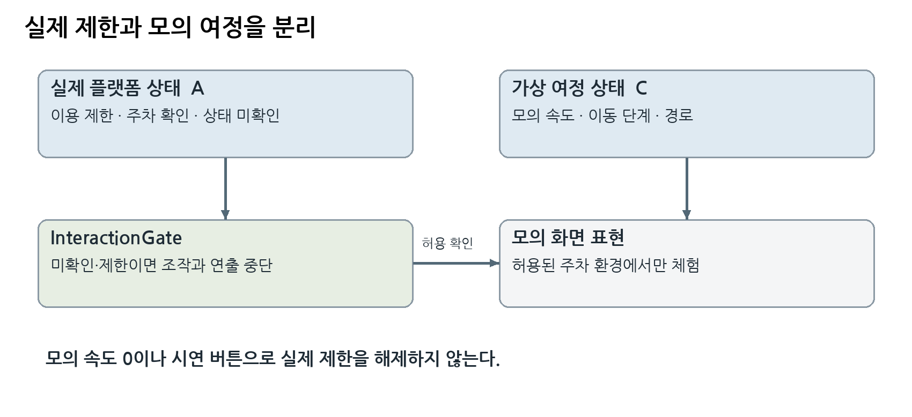

# 4 여정 상태와 게임 규칙

## 4 1 여정 상태를 실제 차량 상태와 분리하기

여정 단계는 IDLE, PREPARING, READY, TRAVELLING, ARRIVED, CANCELLED, ERROR다. 물리적 주행·주차 상태를 나타내지 않는다. DEMO의 TRAVELLING이어도 실제 에뮬레이터는 주차 상태여야 한다. NaviHelper의 onRouteStarted는 경로 탐색 이벤트이므로 이 콜백만으로 자동차가 출발했다고 판정하지 않는다. [S05]

| 현재 상태와 입력 | 결과 | 금지되는 부작용 |
|---|---|---|
| IDLE에서 목적지 선택 | PREPARING, 새 여정 ID | 선택만으로 지역 발견 금지 |
| PREPARING에서 경로 결과 확인 | READY | onRoutingCompleted를 도착으로 오인 금지 |
| READY에서 모의 출발 또는 검증된 주행 신호 | TRAVELLING | 실제 제한 상태를 모의 값으로 변경 금지 |
| READY 또는 TRAVELLING에서 유효한 최종 도착 | ARRIVED, 완료 명령 | 경유지 도착으로 최종 보상 금지 |
| 활성 여정에서 목적지 변경 | revision 증가, 다시 준비 | 과거 목적지 보상 금지 |
| 활성 여정에서 취소 | CANCELLED | 보상·브리핑 성공 연출 금지 |
| SDK 오류 또는 연결 상실 | ERROR와 마지막 확인 상태 | 무조건 도착으로 처리 금지 |
| terminal 상태에서 같은 도착 반복 | 저장 결과 재조회 | 추가 보상 금지 |

READY에서 도착을 받을 수도 있는 이유는 앱이 주행 신호를 관측하지 못해도 최종 도착 자체가 검증될 수 있기 때문이다. 반대로 목적지·여정 일치가 검증되지 않으면 도착 처리를 하지 않는다. SDK가 신뢰 가능한 식별 정보를 제공하지 않는 구간은 자동 인증 기능의 한계로 문서화한다.

## 4 2 Daily Island

DAILY 완료는 한국 날짜 기준 하루 1회 성장 +1, 최대 3단계로 한다. 0단계는 작은 빈 정원, 1단계는 길, 2단계는 꽃밭, 3단계는 휴식 시설이다. 이는 간단한 시각 변화의 기본안이며 정교한 경제 밸런스가 아니다. 같은 날 추가 이동은 캐릭터의 짧은 인사만 보여주고 성장 수치를 올리지 않는다. 거리·속도·이용시간에 보상을 비례시키지 않는다.

서로 다른 날짜의 성장을 시연하려면 실제 기기 시계를 바꾸지 않고 DEMO fixture의 completedAtEpochMs를 사용한다. 이 값은 모의 날짜라고 표시하고 PLEOS 여정에는 주입하지 않는다. 로컬 MVP는 기기 시각 조작을 막는 서버 검증을 제공하지 않으며, 이를 부정 방지 기능으로 홍보하지 않는다.

## 4 3 Journey Archipelago

REGION의 등록 지역 첫 도착은 해당 지역 발견과 음식·의상·장식 3개를 한 번에 부여한다. 발견은 준비된 월드맵 카드를 여는 방식이다. 같은 지역 재방문은 새 보상을 주지 않고 기존 소유물을 보여준다. REGION 완료에 DAILY 성장까지 중복 적용하지 않아 두 규칙을 단순하게 구분한다. 미등록 지역은 일반 완료 안내만 하고 아이템을 임의 생성하지 않는다.

지역 매칭의 기본안은 앱이 선택한 등록 지역 ID와, 현재 내비 목적지의 일치가 확인된 완료다. 위도·경도 기반 실제 상점 방문 인증이나 지오펜싱은 만들지 않는다. 도시별 좌표는 기술 시험용 앵커일 뿐이다. 앱 밖에서 목적지를 바꿔 매칭을 확인할 수 없으면 지역 보상은 보류한다.

## 4 4 아이템과 성장 불변 조건

| 규칙 ID | 반드시 유지할 조건 | 담당 |
|---|---|---|
| INV01 | 보유하지 않은 의상·음식·장식은 적용하지 않음 | B |
| INV02 | 의상 슬롯은 1개, 새 의상 선택은 기존 것을 교체 | B |
| INV03 | 장식 슬롯 3개, 같은 장식은 한 슬롯에만 존재 | B |
| INV04 | 음식은 소모되지 않으며 식사 연출만 수행 | B |
| INV05 | 섬과 동행은 같은 AvatarPreview를 사용 | B와 C |
| INV06 | 수락 전·거절·만료 뒤 가상 캐릭터가 등장하지 않음 | C |
| INV07 | 저장 성공 전 완료·성공 보상 연출을 확정하지 않음 | A와 B |
| INV08 | 모든 모의 수치와 장면은 DEMO 출처를 유지 | 전원 |

성장·소유 상태를 바꾸는 동작은 버튼 비활성화만 믿지 않고 GameService에서도 검증한다. 잘못된 item ID나 슬롯은 오류 결과를 반환하고 이전 상태를 보존한다. 장식은 자유 드래그 대신 슬롯 선택 후 배치해 좌표 충돌·해상도별 복원 문제를 줄인다.

## 4 5 표시와 동작의 제한

실제 플랫폼 제한 또는 상태 미확인은 게임 조작과 방문·식사·꾸미기 연출을 막는다. 속도 0만으로 주차를 추정하지 않는다. A는 플랫폼 이용 허용과 주차 확인의 입력 근거를 D1~2에 검증하고 InteractionGate로 정규화한다. 주차 확인이 안 되면 실제 플랫폼 모드에서 게임 이용을 열지 않는다. 일반 Android Preview는 개발용 가짜 입력이며 차량에서 검증된 제한 처리와 구분한다.

사용 제한 중 도착을 받으면 저장 가능한 최소 처리를 수행하고 브리핑은 보류한다. 앱이 안 보이거나 제한 상태로 바뀌면 애니메이션·시나리오 타이머·방문을 중단한다. 게임 앱이 실제 주행에서 실행되지 않는 플랫폼 정책을 임의 DO 선언이나 오버레이 권한으로 우회하지 않는다. 실제 내비 화면에 캐릭터를 표시하는 장기 컨셉은 정식 통합과 주의 분산 검증을 거쳐야 한다. [S07, S08]
