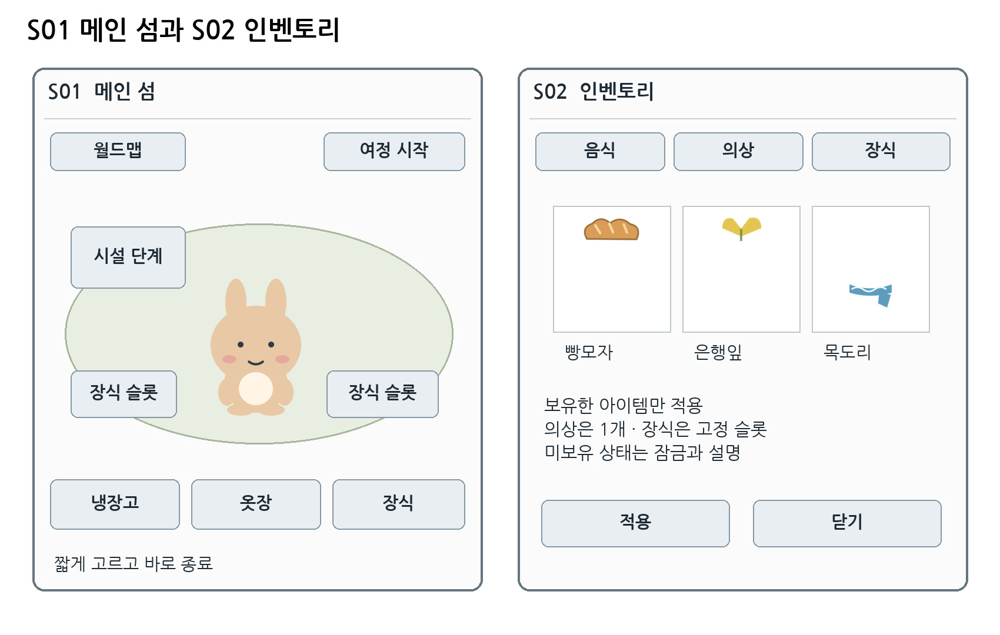
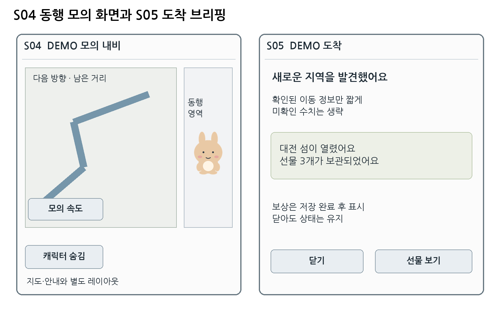
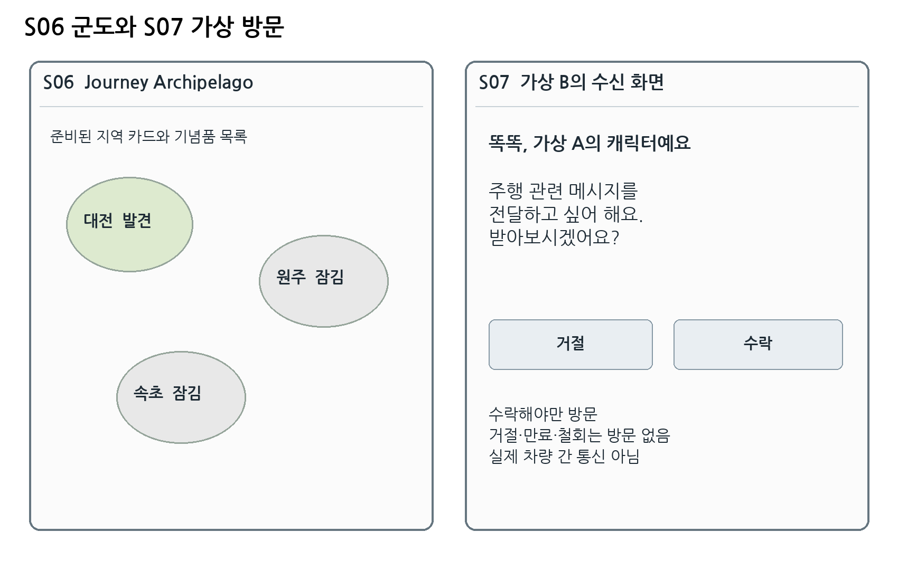

# 5 사용자 경험과 화면 명세

## 5 1 정보 구조와 화면 소유권

메인 섬을 중심으로 짧은 메뉴가 열리는 구조로 만든다. 음식·옷장·장식은 별도 복잡한 페이지 대신 하나의 인벤토리 시트에서 탭으로 구분한다. 월드맵과 지역 상세가 간단 도감을 겸한다. 여정 정보·SDK 상태·시연 제어를 모두 홈에 노출하지 않는다. 기술 진단은 진행자용 패널에 둔다.

| 화면 ID | 화면과 책임 | 주요 입력 | 사용자 행동과 이동 |
|---|---|---|---|
| S00 | 이용 제한 A | InteractionGate | 제한 이유, 사용 가능 시 이전 안전 화면 |
| S01 | 메인 섬 B | GameSnapshot | 냉장고·옷장·장식·월드맵·여정 시작 |
| S02 | 인벤토리 B | 보유 목록과 현재 선택 | 먹기·입기·놓기·해제, 닫으면 섬 |
| S03 | 여정 준비 A | 등록 목적지, 연동 상태 | 지역 선택·요청·취소, 준비 후 모의 화면 |
| S04 | 동행 모의 화면 C | JourneySnapshot, AvatarPreview | 캐릭터 숨김, 실제 게임 조작 없음 |
| S05 | 도착 브리핑 PM | ArrivalReceipt | 닫기·선물 보기, 자동으로 보상 재지급 없음 |
| S06 | 월드맵과 지역 상세 C | 발견·소유의 읽기 모델 | 지역 선택·기념품 상태, 필요 시 S02 요청 |
| S07 | 가상 방문 C | VisitState, 가상 A·B | 요청·수락·거절·닫기, 목적 공개 |
| S08 | 시연 제어 C | DEMO 목록과 현재 상태 | 시나리오 시작·정지·가상 응답·초기화 요청 |

기존에 제안된 화면 8개를 모두 독립 메뉴로 만들지 않는다. 꾸미기·인벤토리, 월드맵·도감을 합쳐 구현량과 길 찾기 부담을 줄인다. 기능 의미는 유지한다. S07은 S04를 가정한 방문 시나리오에서 열리지만 실제 주행 중 팝업 허용을 주장하지 않는다.

## 5 2 와이어프레임

S01은 중앙 캐릭터, 뒤쪽 시설·장식 슬롯, 하단의 냉장고·옷장·장식, 상단의 월드맵·여정 버튼을 둔다. 처음에는 캐릭터를 선택하는 시트만 한 번 연다. 이름 입력을 필수로 만들지 않는다. 기본 이름으로 시작할 수 있어 키보드·입력 검증을 줄인다. 음식은 캐릭터가 앉아 먹는 1~2초 반응, 의상은 선택 즉시 반영, 장식은 슬롯을 눌러 배치한다. 연출 중에도 닫기·종료를 방해하지 않는다.

S04는 자체 제작한 모의 지도와 속도·방향·도착 정보를 둔다. 캐릭터 전용 영역을 레이아웃 단계에서 예약하고 지도 위를 자유롭게 돌아다니게 하지 않는다. 가로 화면은 지도와 좁은 동행 영역을 나누고, 세로 화면은 중요 안내 아래의 작은 영역을 사용한다. 실제 지도·현대차 내비 화면을 그대로 캡처해 자사 구현처럼 사용하지 않는다. 개발용 모의 지도는 추상 경로와 단순 도형으로 그린다.

S05는 제목 한 줄, 확인된 이동 정보 0~2개, 섬 변화 한 줄, 선물 목록, 닫기·선물 보기를 제공한다. 정보가 없으면 해당 행을 생략하거나 확인되지 않았다고 표시한다. DEMO면 상단 배지를 유지한다. 신규 지역·일상 성장·재방문·보상 없음의 결과와 측정값 누락 샘플을 구분한다. 저장 실패는 A의 오류 화면으로 처리하고 성공 브리핑을 열지 않는다.

S06의 지도는 실제 도로 지도가 아니라 군도 선택 보드다. 미발견 지역은 이름과 잠긴 상태, 발견 지역은 아이콘과 보유 목록을 표시한다. S07은 발신 목적을 먼저 제시하고 수락·거절을 동등하게 누를 수 있게 한다. 단순 방문을 수락한 뒤 갑자기 주행 불만을 노출하는 흐름은 금지한다.

와이어프레임은 픽셀 단위 완성 디자인이 아니라 공통 배치와 동작 계약이다. 담당자는 해당 영역 안의 간격·표현을 바꿀 수 있다. 바꾸려는 디자인이 다른 화면 입력·상태·이동 경로를 바꾸지 않으면 PM 승인을 기다릴 필요가 없다.

## 5 3 공통 UI 규칙

앱은 한국어 한 언어로 시작한다. UI 문구는 짧게 쓰고 아이콘에 텍스트를 함께 제공한다. 기본 터치 영역은 56dp 이상을 개발 초기값으로 잡되, 차량용 공식 UI 기준과 실제 창 크기를 확인해 더 큰 요구가 있으면 따른다. 이 숫자는 차량 안전 인증 기준이 아니다. [S07]

색상만으로 발견·오류·연동 상태를 구분하지 않는다. 글자와 아이콘을 함께 쓰고 이미지에는 의미 있는 접근성 설명을 붙인다. 음식 먹는 장면·표정 변화는 필수 정보를 독점하지 않는다. 애니메이션 축소·캐릭터 숨김을 제공하고 음향 효과·자동 TTS는 기본 제외한다. 짧은 정차가 주차와 같다고 가정하지 않는다.

모든 화면에 로딩·빈 상태·오류·이용 제한의 동작이 있어야 한다. 로딩은 무한 회전 대신 제한 시간 뒤 다시 시도와 DEMO로 돌아갈 선택지를 준다. 뒤로 가기는 시트를 먼저 닫고 화면을 한 단계만 돌아간다. 도착 완료 후 뒤로 가기로 완료 함수를 다시 호출하지 않는다. 앱이 background로 가면 화면 연출을 중단하고, 재개할 때 현재 저장 상태에서 다시 그린다.

가로·세로 및 창 크기 변화는 레이아웃 재배치로 대응한다. 창 크기 전환을 새 사용자 시작이나 새 여정으로 취급하지 않는다. 최소 한 개의 Pleos 기준 창과 작은 창·가로 창을 시험한다. 텍스트 1.3배에서 버튼이 잘리지 않는지도 확인한다. 화면별 테스트 자동화 수를 늘리기보다 실제 사용 흐름을 먼저 확인한다.

## 5 4 시연 스토리보드

| 컷 | 예상 구간 | 화면과 진행 | 전달할 의미 |
|---|---|---|---|
| 1 | 0~15초 | S01 새 상태에서 캐릭터 선택 | 나의 섬과 동행 캐릭터 |
| 2 | 15~30초 | S02 기본 차림 확인 후 복귀 | 미보유 항목은 잠금, 획득 후 꾸미기 |
| 3 | 30~50초 | S03 DEMO 일상 여정 선택 | 실제 연동과 모의 입력 구분 |
| 4 | 50~70초 | S04 모의 이동·캐릭터 숨김 | 안내 영역과 동행 영역 분리 |
| 5 | 70~95초 | S05 일상 완료 후 S01 시설 변화 | Daily Island의 기존 공간 성장 |
| 6 | 95~120초 | 새 지역 DEMO 도착·S06 발견 | Journey Archipelago의 새 지역 |
| 7 | 120~150초 | 음식 먹기·모자 착용·장식 배치 | 지역이 캐릭터 생활로 연결 |
| 8 | 150~180초 | S07 가상 B 거절, 다시 초기화한 요청 수락 | 동의가 있어야 방문 |
| 9 | 별도 20~40초 | S08 진단에서 실제 SDK 호출 결과 | 실제 수행 범위와 미검증 범위 |

시간은 목표 시나리오이며 공식 영상 제한이나 실측 속도가 아니다. 기능을 전부 길게 설명하기보다 핵심 흐름 영상과 SDK 증거 장면을 나눠 촬영할 수 있다. 실제 SDK가 실패하면 실패 원인·시도 범위를 명확히 밝히며 성공 장면으로 편집하지 않는다.

## 5 5 간단한 사용자 검증

D8~10에 팀 외 성인 3명 내외에게 주차 모의 환경에서 캐릭터 꾸미기, 도착 변화 설명, 가상 방문 거절을 수행하게 한다. 길 찾기에 막힌 위치, 도움 횟수, 소요 시간, 혼동한 문구를 기록한다. 작은 표본의 관찰이며 시장 수요나 안전성을 통계적으로 입증하지 않는다. 아동 모집이나 주행 중 실험은 이번 일정에 넣지 않는다.

정식 무작위 A/B 실험·NPS·장기 리텐션은 2주 프로토타입의 필수 절차가 아니다. 같은 사람이 두 문구를 비교한 결과는 선호 탐색으로만 쓴다. 강의 자료의 UX·A/B 개념은 검증의 필요성으로 반영하고 실제 표본과 실험 설계에 맞게 주장 범위를 제한한다. [L02, L03]
