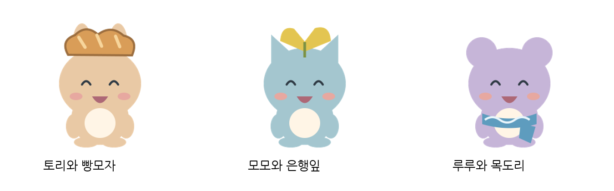

# 6 캐릭터와 지역 콘텐츠 제작

## 6 1 무료 제작 경로

2D 캐릭터를 공통 몸체 규격과 레이어로 만든다. Unity·3D 모델·물리 엔진·유료 Live2D는 필요하지 않다. 기본안은 Compose Box 또는 Canvas에 몸체, 표정, 의상, 손에 든 음식 순서로 겹쳐 그리는 방식이다. Android에서 SVG를 그대로 읽는 새 런타임 라이브러리를 넣기보다 PNG 또는 VectorDrawable로 변환해 로컬 리소스로 묶는다.

이 패키지의 assets/starter에는 팀이 수정할 수 있는 단순한 자체 벡터 초안과 PNG가 들어 있다. 최종 아트나 캐릭터 브랜드로 확정한 결과물은 아니다. 세 외형은 토리·모모·루루라는 작업용 이름을 사용하고, 같은 레이어 규격을 공유한다. B가 색·귀·볼·형태를 조정해 팀 디자인으로 다듬는다. 특정 게임 캐릭터·섬 UI·상표·로고를 복제하지 않는다.

| 항목 | 기본 규격 | 구현 방식 |
|---|---|---|
| 캔버스 | 256 x 256, 투명 배경 | 모든 캐릭터·표정·착용 레이어 동일 |
| 몸체 | 3종 | 얼굴 없는 기본 몸체 PNG |
| 얼굴 | idle, happy, eat 3종 | 동일 좌표의 공통 얼굴 레이어 |
| 의상 | 머리·목 영역 안의 3종 | 1개 슬롯으로 교체, 개별 신체 애니메이션 없음 |
| 음식 | 손 근처에 두는 3종 | 아이콘 또는 먹기 장면에 표시 |
| 장식 | 독립 아이콘 3종 | 섬의 정해진 슬롯에 배치 |
| 섬 배경 | 기본 섬과 시설 3단계 | 단순 도형 또는 고정 배경 전환 |

레이어 파일에는 anchor 규격을 기록하고 도구에서 불필요한 투명 여백을 자동 제거하지 않는다. PNG의 크기를 모두 같게 유지하면 외형마다 모자가 어긋나는 문제를 줄일 수 있다. 원본 SVG는 수정용, PNG는 Android 리소스용이다. 등록 ID는 파일명과 일치하게 매핑하며 사람에게 보이는 이름을 ID로 사용하지 않는다.

## 6 2 표현 상태

B는 한 렌더러에 AvatarPreview와 expression을 받도록 한다. 섬에서는 눈 깜빡임·짧은 들썩임·식사·기쁨을 표현하고, 식사나 아이템 적용의 결과는 연출 종료를 기다리지 않아도 저장된다. 무작위 감정 모델·LLM·감정 추론은 넣지 않는다. 주행 모의 화면은 기본 정지 모습과 제한된 표정만 사용한다. 달리기·춤·화려한 이동은 섬 연출 또는 향후 컨셉으로 둔다.

표현 애니메이션은 화면이 보이고 InteractionGate가 열려 있을 때만 실행한다. 도착 브리핑에서 행복 표정이 끝나도 보상을 다시 적용하지 않는다. 캐릭터 숨김은 C 화면 상태로 유지하고, 의상 선택은 B의 영구 상태로 유지해 서로 저장 권한을 섞지 않는다.

## 6 3 지역 카탈로그

| 지역 ID | 지역 표현 | 음식 | 의상 | 장식 |
|---|---|---|---|---|
| daejeon | 빵을 떠올리는 지역 테마 | 빵 | 빵모자 | 작은 빵 간판 |
| wonju | 은행나무·지역 먹거리 테마 | 감자 음식 아이콘 | 은행잎 머리장식 | 은행나무 |
| sokcho | 바다·음식 테마 | 회 접시 아이콘 | 파도 목도리 | 바다 조개 |

테마는 게임용 자체 콘텐츠 제안이다. 대표 특산물·공식 명물로 인증된 목록이나 제휴 사실로 설명하지 않는다. 성심당 이름·로고 대신 대전의 빵 테마로 표현하고, 도시 방문만으로 특정 가게에 갔다고 기록하지 않는다. 실제 홍보용 문구에 지역 음식·명소의 객관적 사실을 추가하려면 공식 지자체·관광 자료를 별도로 확인한다.

content/catalog.json에는 지역·아이템 ID, 유형, 표시 이름, assetKey, regionId, 시연 좌표를 둔다. PM은 데이터와 문구를 관리하며 B는 아이템 사용 규칙, C는 월드맵 표시를 관리한다. 같은 아이템 목록을 Kotlin 배열과 JSON에 이중으로 수동 관리하지 않는다. 앱은 JSON을 읽어 공통 Catalog로 넘긴다. 빌드 때 코드를 생성하는 파이프라인은 필요하지 않다.

## 6 4 콘텐츠 검증

기본 검증은 ID 유일성, 모든 참조의 존재, 유형과 사용 슬롯의 일치, 지역별 필수 아이템, 파일 경로 존재, 위도·경도 범위, DEMO 출처 표시다. 배포 전에 scripts/validate_content.py를 실행한다. 이것은 콘텐츠 연결의 정적 검사이며 게임 동작·실제 지역 방문·저작권의 자동 인증이 아니다.

누락 자산은 안전한 기본 아이콘으로 표시하고 앱을 중단하지 않는다. 단, 제출 후보에서는 누락 파일을 알려진 결함으로 남기거나 고친다. 오래된 저장에 더 이상 없는 item ID가 있으면 적용을 거부하고 해당 항목만 기본 선택으로 돌아가며, 원본 소유 상태 전체를 무단 삭제하지 않는다.

## 6 5 자산 권리와 제출 관리

자체 제작 파일은 작성자·제작 방식·사용 범위를 assets/ATTRIBUTION.md에 기록한다. 외부 파일을 넣으면 공식 다운로드 위치·라이선스·수정 여부를 추가하고 요구된 고지를 포함한다. 검색 결과에서 무료라고 한 이미지, 게임 스크린샷, 출처 불명 폰트를 복사하지 않는다. 추가 구매를 해야만 사용 가능한 자산은 채택하지 않는다.

AI 이미지를 사용하더라도 정확한 권리·상표 비충돌을 자동으로 보장한다고 쓰지 않는다. 이번 기본안은 코드로 만든 단순 도형과 자체 레이어라 외부 생성 서비스 결제가 없다. 캐릭터 그림의 정교함보다 음식·의상·장식이 실제 동작하고 같은 외형이 유지되는 것을 먼저 완성한다.
