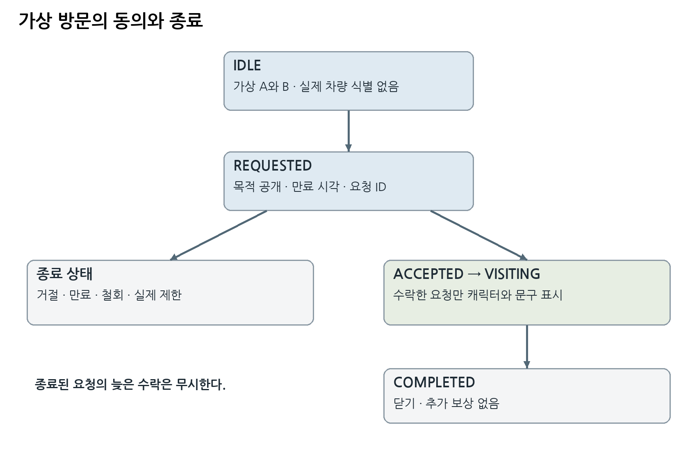

# 7 가상 시나리오와 캐릭터 방문

## 7 1 시뮬레이션 범위

시뮬레이션은 앱 안의 가짜 여정 입력과 가상 A·B 캐릭터로 제품 의도를 보여주는 기능이다. 실제 GPS 이동·두 차량·차량 간 네트워크를 요구하지 않는다. 화면 전환만 된 영상 목업과 달리, 모의 완료가 실제 게임 상태 저장·보상·브리핑으로 연결되도록 구현한다. 이를 실제 이동 인증이나 실제 통신으로 표현하지 않는다.

C는 DemoScenarioRunner를 소유하고, 시나리오 내용은 PM의 fixtures를 읽는다. Runner는 A의 JourneyPort로 목적지를 선택하고 DemoControlPort로 출발·도착·취소를 요청한다. B 저장소를 직접 수정하거나 보상 함수를 우회 호출하지 않는다. 실제 SDK 모드에서 DEMO 입력 버튼은 비활성화한다. 모드 전환은 활성 여정을 취소·정리한 뒤 새 journeyId로 시작한다.

타이머 자동 재생은 선택 기능이다. 처음에는 진행자가 다음 버튼으로 단계를 넘기면 충분하다. 자동 재생을 넣어도 같은 입력을 사용하고, 일시정지·화면 이탈·초기화에서 예약 콜백을 취소한다. 이전 시나리오의 콜백이 새 여정에 도착하지 않도록 generation ID를 검사한다.

## 7 2 최소 시나리오 묶음

| ID | 가정과 입력 | 기대 결과 |
|---|---|---|
| D01 | 당일 DAILY 첫 완료 | 성장 +1, 아이템 없음 |
| D02 | 같은 날 다른 DAILY 완료 | 추가 성장 없음 |
| D03 | daejeon 최초 REGION 완료 | 발견과 3개 선물 |
| D04 | D03의 같은 journeyId 재전달 | 같은 영수증, 새 보상 없음 |
| D05 | daejeon 새 여정 재방문 | 새 선물 없음 |
| D06 | 거리·시간 null인 완료 | 숫자 조작 없이 결과 표시 |
| D07 | 목적지 변경 뒤 오래된 도착 | 과거 지역 보상 없음 |
| D08 | 방문 수락·거절·만료 | 해당 분기만 수행 |
| D09 | SDK 오류 가정 | 오류 표시, 실제 성공 배지 없음 |
| D10 | 실제 제한 상태 또는 시험용 제한 입력 | 실제 제한 우선, 상호작용 중단 |

fixtures/scenarios.json은 이 중 기본 여정 데이터와 기대 결과를 담는다. D07~10의 세부 UI·상태 테스트는 담당자가 구현하면서 추가한다. 모든 오류를 미리 작동하는 시나리오로 제공했다고 오인하지 않는다. 세 도시의 최초 도착은 D03의 regionId를 바꿔 재현한다.

## 7 3 방문 상태 머신

IDLE에서 요청을 만들면 REQUESTED가 된다. 가상 B가 수락한 경우에만 ACCEPTED를 거쳐 VISITING을 표시한다. 거절·철회·만료·플랫폼 제한·화면 이탈이면 해당 종료 상태로 가고 방문을 열지 않는다. 대화 닫기는 COMPLETED다. 모든 종료 상태에서 이전 요청 ID의 늦은 수락을 무시한다.

요청 데이터는 requestId, senderId, receiverId, purpose, presetMessageId, createdAtMonotonicMs, expiresAtMonotonicMs다. 방문은 프로세스 안의 일시 세션이므로 만료·쿨다운은 단조 증가 시계로 계산해 기기 날짜 변경에 영향받지 않게 한다. 테스트에는 가짜 시계를 주입해 15초를 실제로 기다리지 않는다. 실제 번호판·전화번호·위치·음성 파일을 저장하지 않는다. 대상은 가상 A·B 또는 차량 A·B라는 이름으로 표시한다. 번호판을 사용하는 컨셉 장면도 허구 값임을 명시하며 실제 차량 조회처럼 보이지 않게 한다.

요청 기본 만료는 15초, 같은 대상 재요청 간격은 30초, 동시 활성 요청은 1개로 둔다. 개발 기본값이며 효과가 검증된 안전 기준은 아니다. 시연 초기화로 쿨다운을 없앨 수 있지만 일반 화면의 숨겨진 반복 발송 기능으로 만들지 않는다. 단말 재시작 시 방문 세션은 복원하지 않고 종료한다.

방문 분기 재시연은 C의 가상 방문 세션만 초기화한다. 전체 게임 초기화와 버튼 이름·동작을 구분한다. 전체 초기화는 A가 실행 중 여정·Runner·방문을 먼저 취소한 뒤 B의 게임 초기화를 요청하며 사용자에게 소유·성장이 지워짐을 확인받는다. 초기화 중에는 새 시나리오 입력을 받지 않는다.

## 7 4 문구와 동의

요청 문구는 “뒤 차량의 캐릭터가 주행 관련 메시지를 전하고 싶어 해요. 받아보시겠어요?”처럼 목적을 먼저 보여준다. 수락 버튼과 거절 버튼은 쉽게 구분하며 거절해도 게임 불이익이 없다. 무응답은 동의가 아니다. 요청 횟수·수락·차선 변경에 보상을 주지 않는다.

전달 문구는 “혹시 추월 중이 아니라면, 안전할 때 주행차로를 확인해 주실 수 있을까요?”처럼 사전 작성된 표현을 쓴다. 앱이 상대의 차로 위반을 판단하거나 즉시 차선을 바꾸라고 지시하지 않는다. 메시지를 받아보는 동의와 운전 행동에 동의하는 것은 다르다. 자유 입력·욕설 필터·LLM 정중화는 이번에 넣지 않는다.

음성으로 “길동아”를 부르는 컨셉은 진행자가 시나리오를 선택하거나 사전 작성 자막을 표시하는 방식으로 재현한다. 실제 wake word·STT·음성인식 연결이 됐다고 표기하지 않는다. 창문을 열어 직접 다투는 상황을 줄일 수 있다는 것은 설계 의도이며 실제 갈등 감소 효과는 후속 검증 대상이다.

## 7 5 네트워크를 쓰지 않는 구현

한 프로세스 안에 발신 A와 수신 B의 상태를 두고 수신자 시점 버튼으로 전환한다. 두 화면에 같은 VisitController의 읽기 상태를 연결한다. WebSocket·블루투스·Firebase·별도 HTTP 서버는 필요하지 않다. 심사위원이 요청·거절·수락·방문을 직접 바꿔볼 수 있게 하면 의도 전달에 충분하다.

실제 서비스로 확장할 때는 대상 식별, 위치 노출, 차량 소유자 인증, 스팸, 동의 철회, 전달 신뢰성, 플랫폼 입력 허용을 새로 설계해야 한다. 로컬 시뮬레이션만으로 해결된 문제로 설명하지 않는다. 이번 설계에서 그 비용을 미리 구현하지 않는다.

## 7 6 시연 입력의 실제 연결

기본 재생은 초기화 확인, 지역 또는 DAILY 선택, A의 목적지 요청 결과와 READY 확인, 모의 출발, 모의 완료, B의 저장 결과 확인 순서다. C는 GameService를 직접 호출하지 않는다. D04에는 RepeatLastArrival를 쓰고 선행 시나리오가 마지막 도착인지 확인한다. 고정 UUID를 화면에서 강제로 지정하지 않는다.

의상 반영은 B의 최신 GameSnapshot.avatar를 AppRoot가 C의 화면에 전달하는 방식이다. 모의 지도는 C가 Compose Canvas나 단순 도형으로 만들고 유료 지도 SDK·외부 지도 타일을 사용하지 않는다. 경로·속도·거리 텍스트에 모의 출처를 표시한다. 실제 목적지 요청 확인 장면은 A의 SDK 상태 패널로 따로 보여준다.

외부 음성 입력과 네트워크 통신은 없으며 자막·고정 문구·단일 프로세스 A/B 시점 전환으로 의도를 보여준다. 수락·거절·만료 시험은 상태 머신과 가짜 단조 시계로 자동 확인하고, 시연에서는 사람이 버튼을 누른다. 데모 진행 편의로 실제 차량 gate를 바꾸는 버튼은 제공하지 않는다.
