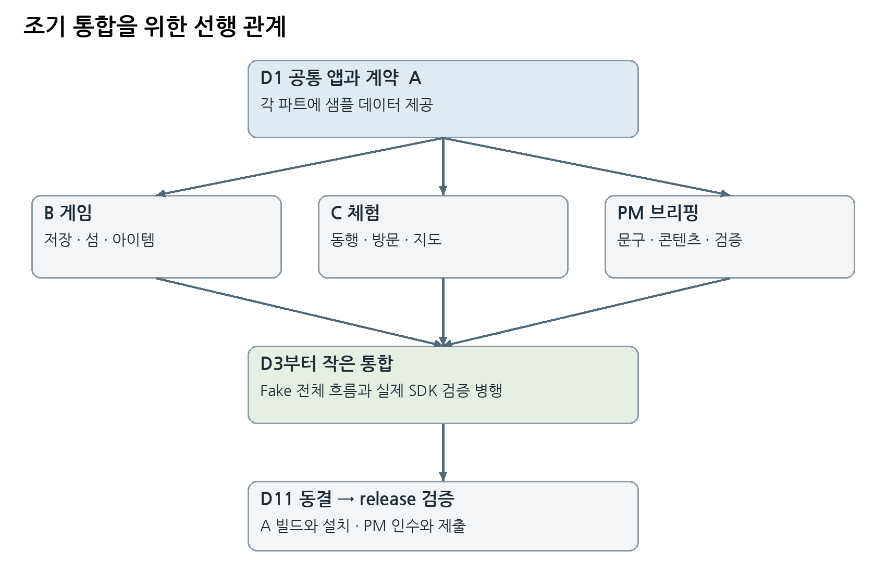

# 13 일정과 위험 관리

## 13 1 14일 작업 계획

착수일은 팀이 정한다. D1부터 D14는 상대 일정이며, 실제 가능 시간과 장비를 확인한 뒤 계획한다. 개발 노력의 예시는 A·B·C 각각 약 30시간, PM 약 15시간이다. PM의 일정·검수·발표 관리 시간은 추가로 필요하다. 이 시간으로 성공이 보장되는 추정은 아니며 경험·SDK 문제·가용 시간에 따라 기능 수량을 줄인다.

| 기간 | A | B | C | PM | 통과 기준 |
|---|---|---|---|---|---|
| D1 | 빈 앱·공통 타입·SDK spike | 순수 게임 규칙·가짜 저장 | 방문 상태와 임시 화면 | 콘텐츠·브리핑 설계·repo 생성 | 각자 시작 가능한 계약·샘플 |
| D2 | 에뮬레이터·제한 신호·라우터 | 게임 저장·멱등 처리 | 모의 동행·가상 A·B | 브리핑 샘플 구현 | 첫 공통 실행·SDK 결과 기록 |
| D3~4 | Fake 여정→게임 연결 | 섬·인벤토리 1개 지역 완성 | 월드맵·방문 분기 | 문구·콘텐츠 검증 | 한 지역 전체 흐름 main 통합 |
| D5~6 | 실제 입력 어댑터 보완 | 외형 3종·아이템 확장 | 시연 패널·반복 재생 | 브리핑 5상태·데이터 정리 | DAILY와 REGION 시각적 구분 |
| D7 | SDK 실제 재검증·전체 빌드 | 저장·복원 교차 확인 | 화면 크기·방문 취소 | 인수 중간 점검 | 통합 시험·부담 재배분 |
| D8~10 | 제한·생명주기·release 준비 | 중복·저장 실패 수정 | UX·재현·타이머 수정 | 사용자 관찰·제안서·브리핑 수정 | 핵심 인수 통과 |
| D11~12 | 기능 동결·결함 수정 | 치명 결함 수정 | 시연 안정화 | 범위 대조·영상 구성 | 미완성 선택 기능 제거 |
| D13 | 최종 release·설치·태그 | 재현 보조 | 시연 3회·영상 | 양식·동의·심사 접근 확인 | 동일 SHA의 APK·문서 |
| D14 | 최종 상태 유지·치명 오류 대응 | 최종 교차 점검 | 재현 지원 | 접수 확인·필요 시 수정 제출 | 치명 결함 0, 한계 명시 |

## 13 2 선행 관계와 조기 통합

공통 타입·기본 앱·샘플 입력 다음에는 B·C·PM을 병렬로 진행한다. SDK 성공은 이 세 파트의 착수 조건이 아니다. 한 지역 완료 흐름과 저장 트랜잭션 연결이 초기 통합의 핵심 경로다. 실제 SDK 검증, 나머지 지역·캐릭터 추가, 시연 재생 고도화는 나중에 합칠 수 있다. D13 release 설치가 처음 통합하는 시점이 되어서는 안 된다.

문서상 B→PM 브리핑의 연결은 필요하지만 PM은 샘플 ArrivalReceipt로 먼저 개발한다. B→C 외형 전달도 임시 AvatarPreview로 시작한다. 실제 의존성과 기다려야 하는 시간을 분리하는 방식이다. 강의의 WBS·선행 관계·리스크 개념을 적용하되 작업 하나하나에 승인 절차를 추가하지 않는다. [L03]

## 13 3 위험 분석

아래 우선도는 발생 확률의 통계가 아니라 영향과 불확실성에 따른 정성 판단이다. 점수를 곱해 객관적 예측처럼 제시하지 않는다. 조기 신호가 보이면 해당 담당자가 먼저 작은 대응을 수행하고, 핵심 범위·일정이 바뀔 때 PM에게 올린다.

| 위험 | 원인과 영향 | 조기 신호 | 대응과 소유자 |
|---|---|---|---|
| 높음 SDK 실행 실패 | 환경·버전·서비스 차이로 실제 연동 미완 | D2 기본 호출 미성공 | A 시간 제한 spike, DEMO 독립, 실패 범위 공개 |
| 높음 PM 병목 | 모든 통합·검토를 PM이 담당 | 검토 대기·설계 질문 누적 | 교차 리뷰·기능 소유권, 범위 변경만 PM |
| 높음 B 구현량 과다 | 섬·저장·캐릭터를 함께 제작 | D4 한 지역 미완 | 자산 변형·표시 작업 이동, 저장 도메인은 유지 |
| 높음 중복 보상 | 콜백·재구성·재시작 반복 | 인벤토리·성장 증가 반복 | B 단일 트랜잭션·영수증·U01 |
| 높음 실제와 모의 혼동 | 소스 혼합·성공 연출 | DEMO 수치를 PLEOS 브리핑에 표시 | source 고정·배지·모드 전환 취소 A |
| 높음 주행 제한 우회 | speed 0 추정·데모 override | 제한인데 버튼 작동 | A 실제 gate 우선, 전원 수동 확인 |
| 중간 목적지 오인 | 변경·재탐색·콜백 식별 불가 | 과거 지역 아이템 지급 | revision·일치 확인, 불명확 시 보류 A |
| 중간 저장 손상 | 다중 작성자·형식 변경 | 재실행 초기화·파싱 오류 | B 단일 저장자·버전·명시 복구 |
| 중간 방문 경쟁 상태 | 만료 후 늦은 수락·중복 요청 | 수락 없이 캐릭터 등장 | C 요청 ID·종료 상태 검사·취소 |
| 중간 화면 크기 | 고정 픽셀·긴 한국어 문구 | 작은 창 버튼 가림 | C 공통 배치 지침, 각자 창 크기 시험 |
| 중간 토큰 소진 | 전체 문서 반복·동시 다중 생성 | 중복 코드·반복 실패 | 작은 작업·handoff·위험 부분만 교차 AI |
| 중간 Actions 비용 | 자동 트리거·artifact 누적 | 잦은 실행·과금 표시 | PM 수동 전용·중단 설정·로컬 기본 |
| 중간 서명·설치 실패 | debug와 release 키 혼동 | 제출 당일 설치 거부 | A D8 첫 release, 같은 키·버전 관리 |
| 중간 자산 권리 | 기존 게임·브랜드 모방 | 출처·라이선스 불명 | B 자체 자산, PM 제출 표현 확인 |
| 중간 장비·팀원 부재 | 실행 PC 하나·인수 부재 | 환경 미확인·작업 중단 | D1 백업 PC, 각자 상태 기록·작은 PR |

## 13 4 고장 형태를 따라 본 방어선

도착 반복은 입력 검증, 저장 안의 처리 ID 확인, UI 재지급 금지의 세 위치에서 막는다. 저장 실패는 성공 브리핑을 열지 않고 같은 명령을 재시도한다. 방문 만료는 타이머만 믿지 않고 수락 처리 시에도 expiresAt와 현재 상태를 확인한다. 화면이 닫혀도 예약 콜백이 남지 않게 정리한다.

실제 제한과 모의 주행을 별도 변수로 분리하면 데모를 편하게 만들다가 실제 제한을 해제하는 설계 실수를 줄일 수 있다. 한 파일에 SDK 타입·게임 저장·브리핑 텍스트를 모두 넣는 방식은 이 구분을 흐리므로 피한다. 완벽한 실패 예방을 약속할 수는 없지만, 오류가 발생하는 경계와 확인 방법을 미리 정한다.

## 13 5 일정이 밀릴 때의 축소 순서

추가 애니메이션·효과음·자동 재생부터 뺀다. 다음으로 외형·아이템의 미술 변형 수, 상세 지도 표현, 부가 통계, 선택 차량 정보를 줄인다. 보상·저장·브리핑·동의 방문·DEMO 출처·실제 제한 처리는 남긴다. 실제 SDK가 끝내 안 되면 성공으로 포장하지 않고 기술 활용성의 한계와 수정 시도 범위를 명시한다.

팀원이 자기 내부 설계를 바꾸는 것은 자유지만, 필수 기능 삭제·하루 이상 지연·추가 비용·계약 파괴는 짧은 변경 요청을 남긴다. 결정까지 기다리는 동안 기존 계약으로 작동하는 임시 구현을 유지한다. 늦어진 일을 PM에게 전부 넘기는 방식으로 일정을 맞추지 않는다.

## 13 6 착수 개정 일정과 수용 기준

기존 상대 D1~D14 계획은 유지하며, 이번에는 D1=2026-11-02 가정과 11-14 18시 내부 제출 목표를 16장에 명시했다. 첫 release는 D8까지 앞당긴다. D3에 한 지역 전체 흐름이 없으면 세 지역과 추가 동작 확장을 중단하고 먼저 연결한다. D7에 보상·저장·동의가 불안정하면 자동 재생과 추가 연출을 삭제한다.

담당자가 1일 이상 지연을 예상하면 현재 완료물·막힌 이유·가장 작은 대안을 PM에게 전달한다. SDK 탐색 중단은 실패를 숨기는 절차가 아니라 핵심 구현을 보존하는 일정 판단이다. 실제 SDK 근거가 부족하면 차량특화성·기술 활용성에 대한 설명의 한계로 제출한다.
